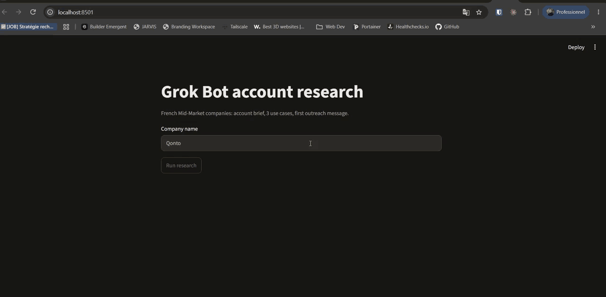
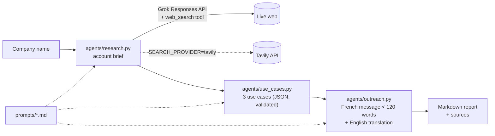

# Grok Account Planner (French Mid-Market)

> **Simulation tool built for application purposes.** Personal project, not affiliated with SpaceXAI, xAI or any company shown.

**An account-planning tool for a sales rep selling Grok Bot to French Mid-Market companies (ETI, 250 to 5,000 employees), built on Grok through the xAI Responses API.**

[**Live demo →**](LIVE_DEMO_URL)

Type a French company name. Get back a sourced account strategy:

1. **Snapshot and AI maturity**: what the company does, size, funding, recent news, and how far it is with AI. Every fact carries its source.
2. **Strategic priorities**: what the company is publicly trying to achieve.
3. **Use-case portfolio**: 5 to 7 Grok Bot (or Grok API) use cases, each tied to a priority, on a value × feasibility matrix.
4. **Stakeholder map, adoption metrics, risks, questions to validate** and a **12-month expansion plan** (land, expand, scale).
5. **A 30/60/90-day plan** and **a first message in natural French** (under 120 words) with its English translation.

Facts and hypotheses are labelled apart, and the planner writes "Not found in public sources" rather than guessing. Export to Markdown or PDF.

## Two ways to run it

| | Web app | Command line |
|---|---|---|
| Entry point | `index.html` + `api/plan.js` (Vercel) | `main.py` (Python) |
| Output | Full account strategy, in the browser | Account brief, 3 use cases, French message (Markdown) |
| Calls | One Grok call: web search + strict JSON schema | Three small agents (research, use cases, outreach) |

### Web app on Vercel (zero npm dependencies)

1. Import this repo in Vercel (no build step needed).
2. Set the environment variables: `XAI_API_KEY`, `ACCESS_CODE` (live generation is closed without it), optionally `GROK_MODEL` and `RATE_LIMIT_PER_HOUR`.
3. Deploy. The demo strategy and ready examples open without a code.

Pre-generate the examples so they open instantly: `python planner.py --examples` (writes `data/plans/*.json`), then commit.

## The problem

Before a first call, a Mid-Market AE spends 30 to 45 minutes per account: reading the website, the French business press, the careers page and LinkedIn, then guessing which use case to open with. The research is repetitive, the output is rarely structured, and the opener often ends up generic ("I saw you're growing fast..."). Outreach to French companies also needs to be written in natural French, not translated English.

This tool turns that into one command: sourced facts first, use cases derived from those facts, then a short message that opens on a real, recent event.

## Demo



_Recorded with the Streamlit UI (`streamlit run app.py`)._

Sample outputs on public French companies (Qonto, Alan, Doctolib) are in [`examples/`](examples/).

### Command line: install (3 commands)

```bash
git clone https://github.com/MZStark/grok-account-research-fr.git && cd grok-account-research-fr
pip install -r requirements.txt
cp .env.example .env   # then set XAI_API_KEY
```

Run:

```bash
python main.py "Doctolib"                      # prints the report
python main.py "Alan" -o examples/alan.md      # writes it to a file
streamlit run app.py                           # optional demo UI
pytest                                         # offline tests, no key needed
```

## Architecture



| Path | Role |
|---|---|
| `agents/research.py` | Builds the account brief from live sources (Grok's built-in `web_search` tool, or Tavily as a fallback). |
| `agents/use_cases.py` | Picks the 3 most relevant Grok Bot use cases from the brief. Asks for strict JSON, validates it, retries once if invalid. |
| `agents/outreach.py` | Writes the first message in French; counts words and asks for a shorter version if it goes over 120, then translates the final message into English. |
| `prompts/` | One plain-text prompt per step, plus `product.md` (what Grok Bot does, so the model never invents features). |
| `core/llm.py` | Grok client through the OpenAI-compatible SDK (`base_url=https://api.x.ai/v1`), with retries and clear error messages. |
| `core/pipeline.py` | Runs the three steps and assembles the report. |
| `main.py` / `app.py` | CLI and optional Streamlit UI. |

**Design choices**

- **Three small agents, not one big prompt.** Each step has one job and its own prompt, so you can read, test and tune them separately.
- **Facts before ideas.** Use cases and the message only see the brief, and every use case must cite the signal it comes from.
- **Structured hand-off.** Step 2 returns validated JSON; a malformed answer is caught and corrected instead of breaking the report.
- **Prompts are data.** They live in `prompts/` as Markdown, editable without touching the code.

## Configuration

All settings live in `.env` (see `.env.example`):

| Variable | Default | Purpose |
|---|---|---|
| `XAI_API_KEY` | (required) | Your xAI API key |
| `GROK_MODEL` | `grok-4.7` | Any Grok model available on your account |
| `XAI_BASE_URL` | `https://api.x.ai/v1` | API endpoint |
| `SEARCH_PROVIDER` | `grok` | `grok` (built-in web search) or `tavily` |
| `TAVILY_API_KEY` | (empty) | Only if `SEARCH_PROVIDER=tavily` |
| `REQUEST_TIMEOUT_S` | `300` | Per-request timeout |
| `MAX_RETRIES` | `3` | Retries on timeouts, rate limits and 5xx errors |

## Error handling

- Missing or invalid settings stop the run before any API call, with a message saying what to fix.
- Timeouts, connection errors, `429` and `5xx` are retried with exponential backoff (1 s, 2 s, 4 s).
- `401` (bad key) and `404` (unknown model) fail immediately with a specific message.
- The CLI exits with code `1` and a one-line error, never a stack trace.

## Known limitations

- **It can be wrong.** The brief depends on what is public and indexed; small or very discreet companies return thin results. The report says "not found" rather than guessing, and lists its sources, but every fact must be checked before sending anything.
- **Recency is not guaranteed.** Web results can surface old articles; the prompt asks for dated news under 12 months old, but cannot enforce it.
- **Use cases are hypotheses**, not a discovery call. They are meant to pick the opening angle, not to replace qualification.
- **The 120-word limit** is checked after generation and retried once; in rare cases the message stays over the limit and the report flags it.
- **Cost and latency**: one run makes four API calls (brief with web search, use cases, French message, English translation), so it typically takes 3 to 5 minutes.
- **No CRM integration** yet: output is a Markdown file.
- **Privacy**: the tool only targets companies and public business information. Do not use it to profile private individuals.

## License

MIT, see [LICENSE](LICENSE).
